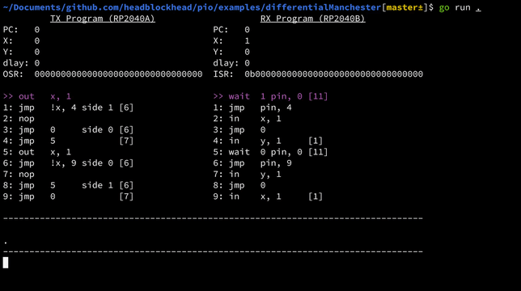

# pio

A Go package that emulates the RP2040's PIO hardware.

See the [examples](examples/README.md) for usage.

## Features, Accuracy, and Limitations

### Features

- Multiple electrically-interconnected RP2040s.
- Complete PIO block (all state machines).
- GPIO feature simulation (pull-ups, pull-downs, overrides).
- Cycle-accurate emulation.
- Support for clock-dividers.
- Usable inside of test suites or as part of another program.
- Provides errors in potentially unintended scenarios (such as performing an undefined operation, or using the value of an uninitialised register).

### Accuracy

This emulator has been made as accurate as possible to the real RP2040's hardware.
However, it does not simulate any analogue components of the RP2040, such as the output drive strength, output slew rate, or input hysteresis of its pads.
Instead, this emulator opts to use a simplified digital model, which is enough to simulate regular driving of pins, pull-ups, pull-downs, and the delay caused by the pad's input/output synchronisers.

### Limitations

Some areas of the PIO's logic are not fully publicly documented in as thorough detail as the rest, and while most of the time I was able to confirm using actual hardware, some educated assumptions have been used in areas where documentation is particularly lacking, and the functionality is inconvenient to create a hardware test for (I'm looking at you, `OUT_STICKY` and `INLINE_OUT_EN`). This should not affect functionality in the vast majority of cases.

This package does not (yet) include an assembler. This means that instructions must be converted to bytecode before they are run using this emulator. This may change in the future.

Finally, this package does not come with a GUI, however it would be nice to be able to interact with the features of this package using a GUI in the future.
I have created a repo ([pio-gtk](https://github.com/headblockhead/pio-gtk)) in which I may build a GUI when I have the time.

If you would like to help write an assembler into this package, feel free to fork and create a PR!
If you would like to help build a GUI around this package, I would appreciate design drafts directed at the [pio-gtk](https://github.com/headblockhead/pio-gtk) repository.

## Licensing

This project is licensed under the GNU AGPLv3 licence.
In short, if you use this package as part of your project, you must also license your project under a copyleft licence.
See [LICENSE.md](LICENSE.md) for more information.
